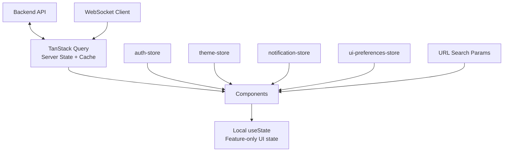

# 07 — State Management Architecture

## Purpose

Defines every category of state in the application, which tool owns each, and the rules that keep server state and client state from being conflated — the single most common source of frontend architecture drift if left implicit.

> Version: 1.0 | Author: ClimateShield Nexus Frontend Architecture Team | Last Updated: 2026-07-27

## Table of Contents

1. [State Categories and Ownership](#state-categories-and-ownership)
2. [Server State](#server-state)
3. [Cache Strategy](#cache-strategy)
4. [Global State](#global-state)
5. [Feature State](#feature-state)
6. [Session State](#session-state)
7. [Theme State](#theme-state)
8. [Notification State](#notification-state)
9. [User State (Preferences)](#user-state-preferences)
10. [State Flow Diagram](#state-flow-diagram)
11. [Anti-Patterns (Explicitly Rejected)](#anti-patterns-explicitly-rejected)
12. [References](#references)
13. [Revision History](#revision-history)

## State Categories and Ownership

| Category | Owner | Persisted? | Scope |
|---|---|---|---|
| Server state | TanStack Query | Cache only (memory + optional persist, see [Cache Strategy](#cache-strategy)) | Global (deduplicated by query key) |
| Global state | Zustand stores (`state/*.ts`) | Selectively (see per-store below) | App-wide |
| Feature state | `useState`/`useReducer` local to feature components, or a feature-scoped Zustand store only if shared across 3+ sibling components | No | Single feature |
| URL state | React Router `useSearchParams` | Via URL (shareable) | Route-scoped |
| Session state | `auth-store` (Zustand) | `sessionStorage` for the access token's in-memory mirror; refresh token never touches JS-readable storage (see [`08_React_Application_Architecture.md#auth-client`](08_React_Application_Architecture.md#auth-client)) | App-wide |
| Theme state | `theme-store` (Zustand) | `localStorage` | App-wide |
| Notification state | `notification-store` (Zustand) | No (ephemeral) | App-wide |
| User preference state | `ui-preferences-store` (Zustand) | `localStorage` | App-wide |

**The governing rule**: if the data originated from the API, TanStack Query owns it — full stop. No Zustand store ever duplicates a piece of server data "for convenience." A component needing both server data and a UI-only flag (e.g., "is this row's detail panel expanded") reads the server data via a query hook and holds the UI-only flag in local `useState`, never merges them into one store object.

## Server State

TanStack Query (v5) owns 100% of data fetched from [`docs/12_API_Specification.md`](../12_API_Specification.md) endpoints. Each feature's `api.ts` defines:

```
// Illustrative shape, not implementation
export const riskAssessmentKeys = {
  all: ['risk-assessments'] as const,
  list: (filters) => [...riskAssessmentKeys.all, 'list', filters] as const,
  detail: (id) => [...riskAssessmentKeys.all, 'detail', id] as const,
};
export function useRiskAssessments(filters) { /* useQuery(...) */ }
export function useApproveAlert() { /* useMutation(...) with cache invalidation */ }
```

- **Query keys are hierarchical and centrally defined per feature** (as above) so invalidation (`queryClient.invalidateQueries({ queryKey: riskAssessmentKeys.all })`) is precise and never a blanket `invalidateQueries()`.
- **Mutations always define `onSuccess` invalidation**, never rely on a manual refetch call from the calling component.
- **Real-time data** (Alerts, Notifications, live dashboard metrics) combines a `useQuery` with a WebSocket subscription (per [`08_React_Application_Architecture.md#websocket-client`](08_React_Application_Architecture.md#websocket-client)) that calls `queryClient.setQueryData` or `invalidateQueries` on inbound events, rather than pure polling — polling (`refetchInterval`) is the fallback when a WebSocket channel doesn't yet exist for that data type.
- **Optimistic updates** are used only for low-risk, easily-reversible actions (e.g., marking a notification read) — never for approval/rejection workflows (Alert approval, User role changes), where waiting for the server's authoritative response is a deliberate trust/audit-integrity choice matching [`docs/database/03_Data_Governance.md#audit-coverage`](../database/03_Data_Governance.md#audit-coverage).

## Cache Strategy

| Data Type | `staleTime` | `gcTime` | Notes |
|---|---|---|---|
| Reference/lookup data (hazard types, severity levels, permission catalog) | `Infinity` | `Infinity` | Matches [`docs/database/02_Performance_Strategy.md#caching-strategy`](../database/02_Performance_Strategy.md#caching-strategy)'s "load once" treatment — fetched once at app boot |
| User's own profile/permissions | 15 minutes | 30 minutes | Matches the backend permission-cache TTL so the frontend never appears "more current" than the API actually is |
| Dashboard/risk data | 2 minutes | 10 minutes | Matches [`NFR-PERF-004`](../05_Non_Functional_Requirements.md#performance)'s risk recomputation cadence |
| Real-time (alerts, notifications) | 0 (always considered stale, WebSocket-driven) | 5 minutes | Cache exists for instant render on remount, not for staleness logic |
| GIS tiles / satellite imagery | Browser HTTP cache (not TanStack Query) | N/A | Tile requests are plain ``/Mapbox-managed requests, not JSON API calls |

## Global State

Only four Zustand stores exist at the global level (see rows above): `auth-store`, `theme-store`, `notification-store`, `ui-preferences-store`. This is a deliberately small number — the project's general anti-premature-abstraction principle applies here as much as to components: a fifth global store requires the same justification a promoted component would (genuinely cross-cutting, used by 3+ unrelated features).

## Feature State

Feature-local state (filter panel open/closed, form wizard step, which table row is expanded) stays in the feature's own components via `useState`/`useReducer`. A feature-scoped Zustand store (e.g., `features/gis/state/map-view-store.ts` for shared viewport state across `MapCanvas` and `MapControls`) is permitted **only within that feature's folder** and is never imported by another feature (per [Import Boundary Rules](01_Folder_and_Project_Structure.md#import-boundary-rules)).

## Session State

`auth-store` holds: `user` (id, name, roles, `admin_boundary_scope`), `permissions` (resolved effective set, from `identity.v_user_effective_permissions`), `accessTokenExpiresAt`. It does **not** hold the raw tokens themselves — token storage/refresh is the Auth Client's responsibility (per [`08_React_Application_Architecture.md#auth-client`](08_React_Application_Architecture.md#auth-client)); the store only reflects derived, UI-relevant session facts. Cleared entirely on logout or a 401 that survives token refresh.

## Theme State

`theme-store` holds `mode: 'light' | 'dark' | 'system'`, hardcoded to `'light'` at MVP per [`05_Design_System_Extensions.md#light-mode-active-and-dark-mode-structural-readiness`](05_Design_System_Extensions.md#light-mode-active-and-dark-mode-structural-readiness) — the store's shape exists now so enabling the toggle later is a UI change, not a state-architecture change.

## Notification State

`notification-store` holds the in-session toast queue (`Toast` components, ephemeral, never persisted) and the unread-count badge value mirrored from the `NotificationCenter`'s underlying TanStack Query data — the store holds only the *count* for the top-bar badge (a cross-cutting UI concern read by the layout, unrelated to any one feature), while the actual notification list remains server state owned by TanStack Query inside the `alerts` feature.

## User State (Preferences)

`ui-preferences-store` holds device/user-local UI preferences that are not server-synced: sidebar collapsed, table density (comfortable/compact), locale selection (English/Swahili — mirrors `i18n.ts`'s active language), default dashboard date-range. Persisted to `localStorage` since these are per-device conveniences, not account settings (account-level settings like notification channel preferences are server state, stored via `identity."user"`-linked API endpoints, not this store).

## State Flow Diagram



## Anti-Patterns (Explicitly Rejected)

- A Redux-style single global store holding everything — rejected because it re-introduces the server/client state conflation this architecture is designed to avoid, and adds boilerplate with no benefit over TanStack Query + a handful of small Zustand stores for a team of this size.
- Storing fetched API data inside a Zustand store "so it survives a component unmount" — TanStack Query's cache already does this; duplicating it creates two sources of truth that can silently disagree.
- Prop-drilling session/theme/permission data through component trees more than 2 levels — use the relevant store's hook directly instead.

## References

- [`docs/06_System_Architecture.md`](../06_System_Architecture.md)
- [`docs/database/02_Performance_Strategy.md#caching-strategy`](../database/02_Performance_Strategy.md#caching-strategy)
- [`08_React_Application_Architecture.md`](08_React_Application_Architecture.md)
- [`database/schema/013_views.sql`](../../database/schema/013_views.sql) (`identity.v_user_effective_permissions`)

## Revision History

| Version | Date | Author | Change |
|---|---|---|---|
| 1.0 | 2026-07-27 | ClimateShield Nexus Frontend Architecture Team | Initial version (Phase 5 frontend architecture) |
