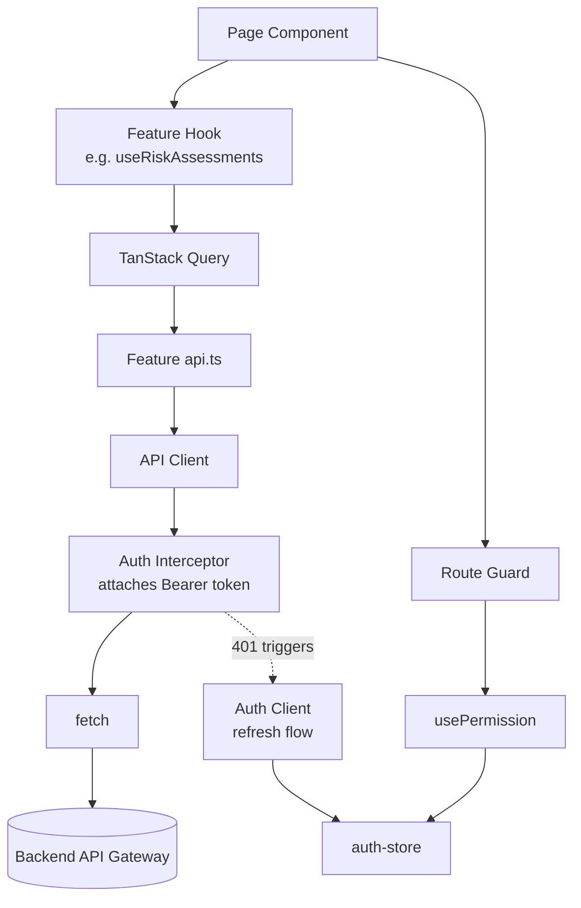

# 08 — React Application Architecture

## Purpose

Defines the application-layer architecture beneath the component/routing layers: hooks structure, the utility layer, the service layer, the API and auth clients, the permission system, route guards' implementation, and error boundary strategy.

> Version: 1.0 | Author: ClimateShield Nexus Frontend Architecture Team | Last Updated: 2026-07-27

## Table of Contents

1. [Application Architecture Diagram](#application-architecture-diagram)
2. [Hooks Structure](#hooks-structure)
3. [Utility Structure](#utility-structure)
4. [Service Layer](#service-layer)
5. [API Client](#api-client)
6. [Authentication Client](#authentication-client)
7. [Permission System](#permission-system)
8. [Route Guards Implementation](#route-guards-implementation)
9. [Error Boundaries](#error-boundaries)
10. [References](#references)
11. [Revision History](#revision-history)

## Application Architecture Diagram



## Hooks Structure

Two tiers, matching [`01_Folder_and_Project_Structure.md`](01_Folder_and_Project_Structure.md):

| Tier | Location | Examples | Rule |
|---|---|---|---|
| Generic/cross-cutting | `src/hooks/` | `useMediaQuery`, `useDebouncedValue`, `usePermission`, `useLocalStorage`, `useAbortableEffect`, `useMotionSafe` | Must not import from any `features/*` |
| Feature-specific | `features/*/hooks/` | `useRiskAssessments`, `useApproveAlert`, `useAIConversation` | Wraps that feature's `api.ts` query/mutation definitions; is the *only* way page components touch server state — no page calls `useQuery` directly against a raw fetch |

Every data-fetching hook returns the TanStack Query result shape directly (`{ data, isLoading, isError, error }`) rather than a custom-remapped shape — keeps the mental model consistent across the whole codebase and avoids a bespoke loading/error convention per feature.

## Utility Structure

`src/utils/` holds only pure, framework-agnostic functions — no React imports, no hooks, independently unit-testable without a component render:

| File | Responsibility |
|---|---|
| `format-date.ts` | Locale- and timezone-aware date formatting (Africa/Nairobi default, per [`docs/19_UI_Design_System.md#localization-considerations`](../19_UI_Design_System.md#localization-considerations)) |
| `format-number.ts` | Locale-aware number/unit formatting (mm, °C, m³/s) |
| `geojson-helpers.ts` | GeoJSON validation/bbox/centroid helpers for map components (pure geometry math only — actual PostGIS computation stays server-side) |
| `severity-color.ts` | Maps a `severity` enum value to its token per [`docs/19_UI_Design_System.md#risk-severity-color-scale`](../19_UI_Design_System.md#risk-severity-color-scale) — the single function every severity-rendering component calls, so the color mapping is never re-implemented per component |
| `validation-schemas.ts` | `zod` schemas mirroring [`docs/validation/`](../validation/) field rules, shared between `react-hook-form` resolvers and any client-side pre-submit checks |

## Service Layer

`src/services/` wraps browser/platform APIs and cross-cutting integrations that are not "fetching this feature's data" (that's the API client + feature `api.ts`):

| Service | Responsibility |
|---|---|
| `api-client/` | Base HTTP client — see [API Client](#api-client) |
| `auth-client/` | Token lifecycle — see [Authentication Client](#authentication-client) |
| `websocket-client/` | Single shared WebSocket connection (alerts, notifications, live dashboard invalidation triggers); exposes a subscribe-by-topic API so features don't each open their own socket |
| `storage-client/` | Thin wrapper over `localStorage`/IndexedDB with namespacing and JSON serialization — the only code permitted to touch these APIs directly (per [Import Boundary Rules](01_Folder_and_Project_Structure.md#import-boundary-rules)); backs [`11_Offline_and_Resilience_Strategy.md`](11_Offline_and_Resilience_Strategy.md) |

## API Client

A single `fetch`-based client (no axios dependency — `fetch` plus a small typed wrapper is sufficient for this API's needs) providing:

- **Base URL + versioning** from [`docs/12_API_Specification.md#conventions`](../12_API_Specification.md#conventions) (`/v1` prefix), configured per environment via `docs/31_Environment_Variables.md`-defined `VITE_API_BASE_URL`.
- **Request interceptor**: attaches `Authorization: Bearer <access_token>` from the Auth Client to every request except the public/unauthenticated endpoints (Landing, Public Dashboard).
- **Response interceptor**: normalizes the API's error envelope ([`docs/12_API_Specification.md#error-format`](../12_API_Specification.md#error-format)) into a typed `ApiError` class (`code`, `message`, `details`, `requestId`) thrown uniformly, so every catching layer (TanStack Query's `onError`, error boundaries) handles one shape.
- **401 handling**: a single in-flight refresh — concurrent requests that 401 simultaneously await one shared refresh call (via the Auth Client) rather than each independently hitting `/v1/auth/refresh`, avoiding a refresh-token race.
- **429 handling**: honors `Retry-After` (per [`docs/12_API_Specification.md#rate-limiting`](../12_API_Specification.md#rate-limiting)) with a single bounded retry, then surfaces the error — no silent infinite retry loop.
- **Request ID propagation**: every response's `request_id` is attached to thrown errors and to any resulting user-facing support message, matching [`docs/17_Coding_Standards.md#error-handling`](../17_Coding_Standards.md#error-handling).

## Authentication Client

- **Access token**: held in memory (a module-level variable inside `auth-client/`, mirrored to `auth-store` only as derived, non-secret facts) — never written to `localStorage`, closing the XSS-token-theft gap that `localStorage`-stored JWTs are prone to.
- **Refresh token**: never touched by JavaScript at all — issued as an `HttpOnly`, `Secure`, `SameSite=Strict` cookie by the backend (per [`identity.user_session.refresh_token_hash`](../../database/schema/002_identity.sql)'s design), sent automatically by the browser to `/v1/auth/refresh`.
- **Silent refresh scheduling**: a timer refreshes proactively ~60 seconds before the access token's 15-minute expiry ([`docs/12_API_Specification.md#authentication`](../12_API_Specification.md#authentication)), so an in-progress user action rarely hits a reactive 401-triggered refresh at all.
- **MFA**: a distinct `auth-client.verifyMfa()` step between login and session establishment for accounts with `identity."user".mfa_method` set — the client never marks a session "authenticated" until this step (if required) completes.
- **Logout**: calls `/v1/auth/logout` (server-side session revocation, per [`identity.user_session`](../../database/schema/002_identity.sql)) before clearing local state — a logout is never purely a client-side state clear, since a stolen refresh cookie must actually be invalidated server-side.

## Permission System

- **Source of truth**: `identity.v_user_effective_permissions` ([`database/schema/013_views.sql`](../../database/schema/013_views.sql)), fetched once at login and refreshed on the same cadence as the token refresh cycle (15 min, matching [`docs/database/02_Performance_Strategy.md#caching-strategy`](../database/02_Performance_Strategy.md#caching-strategy)).
- **`usePermission(code: PermissionCode): boolean`** hook is the single check primitive — every conditional render of a nav item, action button, or route uses this hook rather than inspecting `user.roles` directly, so permission logic (not just role-name string matching) stays centralized and consistent even as the RBAC model evolves.
- **`PermissionCode` is a generated TypeScript union type** sourced from [`database/seeds/001_permissions.sql`](../../database/seeds/001_permissions.sql)'s catalog (via the same OpenAPI/schema-generation tooling referenced in [`docs/database/05_ORM_Model_Specifications.md`](../database/05_ORM_Model_Specifications.md)) — a typo'd permission string is a compile error, not a silent always-false check.
- **Boundary scope**: `usePermission` optionally accepts an `adminBoundaryId` argument, checked against the user's `admin_boundary_scope` array — a Disaster Management Officer scoped to Kisumu County fails a permission check for a Nairobi-scoped resource even with the right role.

## Route Guards Implementation

Restated from [`03_Routing_and_Navigation_Architecture.md#route-guards`](03_Routing_and_Navigation_Architecture.md#route-guards) at the code-architecture level: guards are plain wrapper components composed in `routes/route-tree.tsx`, not route `loader` throws — this keeps the "why was I redirected/blocked" logic in one readable place (React component tree) rather than split between loaders and error boundaries.

```
<RequireAuth>
  <DashboardLayout>
    <RequirePermission code="user.manage">
      <UsersPage/>
    </RequirePermission>
  </DashboardLayout>
</RequireAuth>
```

Guards call `usePermission`/read `auth-store` — they contain no permission logic of their own, keeping [Permission System](#permission-system) the single source of truth.

## Error Boundaries

Three tiers, from narrowest to widest:

| Tier | Scope | Behavior |
|---|---|---|
| Widget-level | An individual chart/map/AI component | Catches render errors from that one widget only; renders an inline "this widget failed to load" card with retry — the rest of the dashboard stays usable |
| Route-level | One route subtree (React Router `errorElement`) | Catches loader errors and uncaught render errors within that route; renders within the parent layout still valid (per [`04_Layouts.md#error-layout`](04_Layouts.md#error-layout)) |
| Root-level | The entire app | Last-resort catch for errors escaping the router itself (e.g., a provider-level crash); renders a standalone minimal error page with a reload action and no assumption that any app chrome/state is safe to render |

Every error boundary reports the caught error (with `request_id` if available) to the observability pipeline defined in [`docs/29_Logging_and_Monitoring.md`](../29_Logging_and_Monitoring.md) before rendering its fallback — a caught error is never silent, matching [`docs/17_Coding_Standards.md#error-handling`](../17_Coding_Standards.md#error-handling)'s "never swallow exceptions silently" rule.

## References

- [`docs/12_API_Specification.md`](../12_API_Specification.md)
- [`docs/13_Security_Design.md`](../13_Security_Design.md)
- [`docs/17_Coding_Standards.md#error-handling`](../17_Coding_Standards.md#error-handling)
- [`database/schema/002_identity.sql`](../../database/schema/002_identity.sql), [`013_views.sql`](../../database/schema/013_views.sql)
- [`07_State_Management_Architecture.md`](07_State_Management_Architecture.md)

## Revision History

| Version | Date | Author | Change |
|---|---|---|---|
| 1.0 | 2026-07-27 | ClimateShield Nexus Frontend Architecture Team | Initial version (Phase 5 frontend architecture) |
