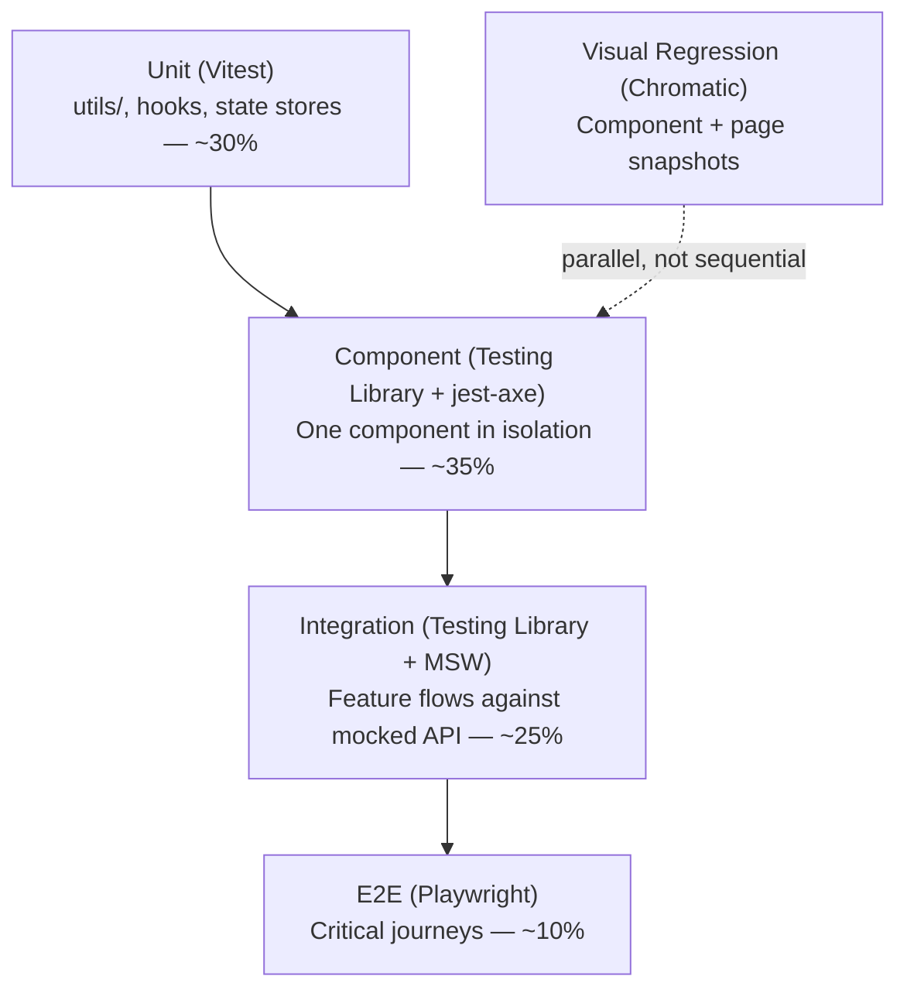

# 13 — Frontend Testing Strategy

## Purpose

Applies [`docs/14_Testing_Strategy.md`](../14_Testing_Strategy.md)'s test pyramid and tooling choices specifically to the `frontend/` workspace — what gets tested at each layer, with what tool, and to what coverage bar. Does not redefine the backend/ML/data testing strategy already covered there.

> Version: 1.0 | Author: ClimateShield Nexus Frontend Architecture Team | Last Updated: 2026-07-27

## Table of Contents

1. [Frontend Test Pyramid](#frontend-test-pyramid)
2. [Unit Testing](#unit-testing)
3. [Component Testing](#component-testing)
4. [Integration Testing](#integration-testing)
5. [End-to-End Testing](#end-to-end-testing)
6. [Visual Regression Testing](#visual-regression-testing)
7. [Accessibility Testing](#accessibility-testing)
8. [Mocking Strategy](#mocking-strategy)
9. [Coverage Targets](#coverage-targets)
10. [CI Integration](#ci-integration)
11. [References](#references)
12. [Revision History](#revision-history)

## Frontend Test Pyramid

Matches the shape (not the exact tooling) of the root [`docs/14_Testing_Strategy.md#test-pyramid`](../14_Testing_Strategy.md#test-pyramid) — Vitest replaces Jest specifically for the `frontend` workspace since it shares Vite's config/transform pipeline directly (no separate Babel/ts-jest config to maintain), while backend services continue to use Jest per the root strategy.

## Unit Testing

**Tool**: Vitest. **Scope**: `src/utils/`, `src/hooks/` (generic ones), Zustand store logic, and any feature's `api.ts` query-key/transform functions in isolation — no React rendering involved.

- Every function in `src/utils/` (per [`08_React_Application_Architecture.md#utility-structure`](08_React_Application_Architecture.md#utility-structure)) has a corresponding test file, since these are pure and cheapest to test exhaustively — `severity-color.ts` and `validation-schemas.ts` in particular are tested against every enum value/rule they cover, not just a happy-path sample.
- Zustand stores are tested as plain objects (create the store, call its actions, assert state) — no component wrapper needed.

## Component Testing

**Tool**: React Testing Library + Vitest, `jest-axe` (works with Vitest via its Jest-compatible matcher API) for accessibility assertions inline.

- Every component in [`06_Component_Inventory.md`](06_Component_Inventory.md) above the `primitives` layer has interaction tests (click, type, keyboard nav) written against rendered output and accessible roles (`getByRole`, not `getByTestId` as a first resort — testing what a user/assistive-technology actually perceives, not implementation details).
- Feature components (`FloodRiskMap`, `AIConversationThread`, ...) are tested with MSW-mocked API responses (see [Mocking Strategy](#mocking-strategy)), asserting on rendered states (loading skeleton → data → error) rather than mocking the feature hook itself — keeps the test honest about the real data-fetching integration.
- `jest-axe`'s `toHaveNoViolations()` assertion runs in every component test as a baseline check, in addition to (not instead of) the Storybook-level a11y addon (per [`12_Component_Documentation_and_Storybook_Plan.md#addons-and-configuration`](12_Component_Documentation_and_Storybook_Plan.md#addons-and-configuration)) — belt-and-suspenders since the two run in different environments (JSDOM vs. a real browser via Storybook).

## Integration Testing

**Tool**: React Testing Library + MSW, rendering a full feature's page component (with router, QueryClient, and store providers via the shared `test-utils.tsx` custom `render()`).

- Verifies a full user flow within one feature stays correct end-to-end at the component-tree level: e.g., "Alerts page: filter by severity → table updates → click alert → detail drawer opens → approve → toast confirms → table refetches."
- Route guards are exercised here too: a test renders the route tree with a mocked `auth-store` state (various roles/permissions) and asserts the correct guard behavior (redirect, 403 page, or successful render) per [`03_Routing_and_Navigation_Architecture.md#route-guards`](03_Routing_and_Navigation_Architecture.md#route-guards).

## End-to-End Testing

**Tool**: Playwright (same tool as the root strategy, per [`docs/14_Testing_Strategy.md#test-types--tooling`](../14_Testing_Strategy.md#test-types--tooling)), run against a real (staging/preview) backend, not MSW mocks — this is the one test tier that intentionally crosses the frontend/backend boundary for real.

Critical journeys covered (one Playwright spec per journey, in `frontend/e2e/`):

| Journey | Why Critical |
|---|---|
| Login → MFA (where applicable) → role-correct default dashboard | Every other journey depends on auth working |
| Disaster Management Officer: view Risk Dashboard → drill into Flood Risk → approve a pending alert | The platform's core public-safety workflow |
| Meteorologist: review forecast → publish advisory | Core forecasting workflow |
| GIS Analyst: upload/publish a new GIS layer version | Exercises the file-upload + spatial-metadata path |
| Public User: view Public Climate Dashboard unauthenticated, subscribe to alerts | The one fully public-facing critical path |
| Administrator: create user → assign role → verify effective permissions | Exercises the full RBAC chain from [`docs/database/`](../database/) through to the UI |

## Visual Regression Testing

**Tool**: Chromatic (or an equivalent Storybook-snapshot-based service, per [`12_Component_Documentation_and_Storybook_Plan.md#addons-and-configuration`](12_Component_Documentation_and_Storybook_Plan.md#addons-and-configuration)).

- Runs against every story on every PR — a pixel-level diff requires explicit human approval before merge, catching unintended styling regressions that functional tests cannot (e.g., a Tailwind config change subtly shifting spacing across every `Card`).
- Deliberately **not** run against full application pages (too high false-positive rate from dynamic content like timestamps/live data) — scoped to the component library, where it is high-signal.

## Accessibility Testing

Three layers, consolidating what's introduced across this document and [`10_Accessibility_and_Internationalization_Strategy.md#automated-accessibility-enforcement`](10_Accessibility_and_Internationalization_Strategy.md#automated-accessibility-enforcement):

1. `jest-axe` inline in component tests (fast feedback, every PR).
2. Storybook `addon-a11y` on every story (visual, catches issues during development itself).
3. Playwright + `@axe-core/playwright` against 5–6 key full authenticated pages in CI, plus the existing manual screen-reader pass per release cadence.

## Mocking Strategy

- **MSW (Mock Service Worker)** intercepts HTTP requests at the network level for component/integration tests and Storybook — the code under test makes real `fetch` calls through the real [API client](08_React_Application_Architecture.md#api-client); only the network layer is faked. This means a test failure is far more likely to reflect a real integration bug than a mock-drift artifact.
- MSW handlers are seeded from [`mock-data/`](../../mock-data/) (the Phase 3 mock dataset) wherever possible, rather than ad hoc per-test fixtures — keeps frontend test data and the platform's canonical mock dataset from silently diverging.
- MSW handlers mirror the exact response envelope/error format from [`docs/12_API_Specification.md`](../12_API_Specification.md) — a handler returning a shape the real API wouldn't is treated as a bug in the test, not an acceptable shortcut.

## Coverage Targets

| Layer | Minimum Coverage | Notes |
|---|---|---|
| `utils/` | 95% | Pure functions — cheap to cover exhaustively |
| `hooks/` (generic) | 85% | |
| Feature `api.ts` (query/mutation definitions) | 80% | Focus on query-key correctness and error transformation, not re-testing TanStack Query itself |
| Components — Risk Assessment, Alerts, Auth features | 85% | Matches the "highest rigor" bar [`docs/14_Testing_Strategy.md#coverage-targets`](../14_Testing_Strategy.md#coverage-targets) sets for these domains backend-side |
| Components — all other features | 75% | |
| E2E journeys | 100% of the table in [End-to-End Testing](#end-to-end-testing) | A missing critical-journey test blocks release, per [`docs/14_Testing_Strategy.md#ci-quality-gates`](../14_Testing_Strategy.md#ci-quality-gates) |

## CI Integration

Wired into the existing `.github/workflows/` pipeline from Phase 3, as a `frontend`-scoped job set: `lint` → `typecheck` → `unit+component (Vitest)` → `build` → `visual regression (Chromatic)` → `e2e (Playwright, against a preview deploy)`. A failure at any stage blocks merge, per [`QUALITY_GATES.md`](../../QUALITY_GATES.md) — no stage is a "warning only" step for the `frontend` workspace.

## References

- [`docs/14_Testing_Strategy.md`](../14_Testing_Strategy.md)
- [`QUALITY_GATES.md`](../../QUALITY_GATES.md)
- [`mock-data/`](../../mock-data/)
- [`12_Component_Documentation_and_Storybook_Plan.md`](12_Component_Documentation_and_Storybook_Plan.md)

## Revision History

| Version | Date | Author | Change |
|---|---|---|---|
| 1.0 | 2026-07-27 | ClimateShield Nexus Frontend Architecture Team | Initial version (Phase 5 frontend architecture) |
