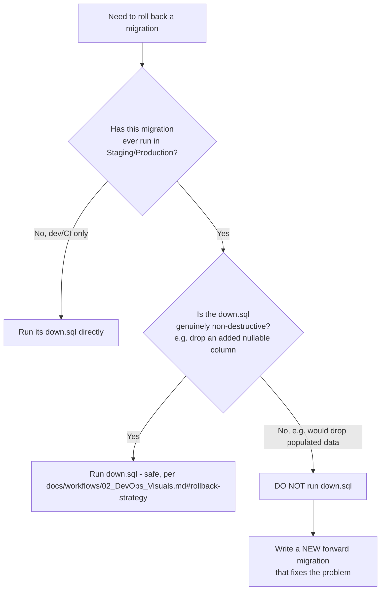

# Migration Strategy

## Purpose

Defines how ClimateShield Nexus's database schema evolves safely over time — naming convention, rollback strategy, versioning, and how reference/seed data is managed distinctly from schema structure. Extends [`docs/17_Coding_Standards.md#database-migrations`](../17_Coding_Standards.md#database-migrations) with the concrete operational procedure.

> Version: 1.0 | Author: ClimateShield Nexus Database Architecture Team | Last Updated: 2026-07-27

## Table of Contents

1. [Relationship Between database/schema/ and database/migrations/](#relationship-between-databaseschema-and-databasemigrations)
2. [Migration Naming Convention](#migration-naming-convention)
3. [Versioning](#versioning)
4. [Rollback Strategy](#rollback-strategy)
5. [Seed Strategy](#seed-strategy)
6. [Reference Data](#reference-data)
7. [Migration Review Checklist](#migration-review-checklist)
8. [Migration Index](#migration-index)
9. [References](#references)
10. [Revision History](#revision-history)

## Relationship Between database/schema/ and database/migrations/

- [`database/schema/`](../../database/schema/) is the **current-state** schema — what a fresh database looks like today, organized by domain for readability (`002_identity.sql`, `007_risk.sql`, etc.).
- [`database/migrations/`](../../database/migrations/) is the **incremental history** — one entry per schema change, in the order they were actually applied to a running database, each with an `up` and `down`.
- Migration `0001_initial_schema` is a deliberate, documented exception: because it is the very first migration, its `up` is by definition the entire current-state schema, so it includes the `database/schema/*.sql` files directly via psql's `\ir` (relative include) rather than duplicating ~900 lines of DDL. **Every migration after 0001 must be a small, standalone, single-purpose file** — see [`0001_initial_schema.up.sql`](../../database/migrations/0001_initial_schema.up.sql)'s own header comment for the full reasoning.

## Migration Naming Convention

```
database/migrations/<NNNN>_<verb>_<short_description>.up.sql
database/migrations/<NNNN>_<verb>_<short_description>.down.sql
```

| Part | Rule |
|---|---|
| `NNNN` | 4-digit, zero-padded, strictly sequential (`0001`, `0002`, ...) — never reused, never reordered, even if a migration is later found to be a mistake (fix it in a NEW migration, per [Rollback Strategy](#rollback-strategy)) |
| `verb` | `add`, `drop`, `alter`, `rename`, `backfill`, `create_index` — states the operation, not the table, first (e.g. `0007_add_column_user_last_login_ip.up.sql`, not `0007_user_last_login_ip.up.sql`) |
| `short_description` | snake_case, specific enough to identify the change from the filename alone in a `git log` listing |

Examples for future migrations: `0002_add_column_alert_source_ip.up.sql`, `0003_create_index_observation_parameter_boundary.up.sql`, `0004_backfill_climate_variable_lookup_swahili_labels.up.sql`.

## Versioning

- The migration sequence number (`NNNN`) IS the schema version — there is no separate semantic-version number for the database schema itself.
- The currently-applied migration number is tracked in a `schema_migrations` bookkeeping table (created by the migration runner, not hand-maintained) recording `(version, applied_at, checksum)` per applied migration.
- A migration's `up.sql` file, once merged to `main`, is **immutable** — never edited after merge, even to fix a typo. A mistake is corrected by a new migration (e.g., `0012_fix_...`), so the history any already-deployed environment has already applied never silently diverges from what's in version control.
- Application release versioning (`vMAJOR.MINOR.PATCH`, [`docs/workflows/02_DevOps_Visuals.md#version-strategy`](../workflows/02_DevOps_Visuals.md#version-strategy)) is independent of migration numbering — a single release may bundle zero, one, or several new migrations.

## Rollback Strategy

Extends [`docs/17_Coding_Standards.md#database-migrations`](../17_Coding_Standards.md#database-migrations)'s "additive-first" principle with the concrete decision tree:



**In practice**: because every migration is written additive-first (add a nullable column, backfill, THEN make it required in a later migration — never all three in one step), a genuinely destructive `down.sql` should be rare after `0001`. `0001`'s own `down.sql` is explicitly documented as dev/CI-only for exactly this reason — by the time `0001` has run in Production, rolling it back would mean deleting all production data, which is never the correct response to any real operational problem.

## Seed Strategy

Seed data is split into two categories, loaded by two different mechanisms:

| Category | Examples | Loaded By | When |
|---|---|---|---|
| **Reference data** | Permissions catalog, 14 system roles, hazard/severity/unit/climate-variable lookups, admin boundaries | [`database/seeds/`](../../database/seeds/) SQL scripts, idempotent (`ON CONFLICT DO NOTHING`) | Once per environment, immediately after migrations, and re-run safely on every deploy |
| **Mock/demo data** | [`mock-data/`](../../mock-data/)'s 15 datasets | [`scripts/seed-database.sh`](../../scripts/seed-database.sh) | Local development and CI only — **never** run against Staging/Production |

Reference data seeds are idempotent by design (safe to re-run) so a redeploy never fails or duplicates rows; mock data seeds are explicitly gated to non-production environments in `scripts/seed-database.sh`'s own logic (checking `APP_ENV`).

## Reference Data

The following tables are reference/lookup data whose CONTENTS are managed via [`database/seeds/`](../../database/seeds/), even though their STRUCTURE is managed via `database/migrations/`:

| Table | Seed File |
|---|---|
| `identity.permission` | [`database/seeds/001_permissions.sql`](../../database/seeds/001_permissions.sql) |
| `identity.role` (14 system roles) | [`database/seeds/002_roles.sql`](../../database/seeds/002_roles.sql) |
| `identity.role_permission` (RBAC matrix grants) | [`database/seeds/003_role_permissions.sql`](../../database/seeds/003_role_permissions.sql) |
| `climate.hazard_type_lookup`, `severity_lookup`, `unit_lookup`, `climate_variable_lookup` | [`database/seeds/004_climate_lookups.sql`](../../database/seeds/004_climate_lookups.sql) |
| `spatial.admin_boundary` (national + 47 counties) | [`database/seeds/005_admin_boundaries.sql`](../../database/seeds/005_admin_boundaries.sql) |
| `ops.feature_flag` | [`database/seeds/006_feature_flags.sql`](../../database/seeds/006_feature_flags.sql) |
| `ops.task_queue` | [`database/seeds/007_task_queues.sql`](../../database/seeds/007_task_queues.sql) |

A change to reference data VALUES (e.g., adding a new permission) is a new/updated seed file, re-run idempotently; a change to reference data STRUCTURE (e.g., adding a column to `permission`) is a schema migration. These are frequently confused — the test is: "does this change what a fresh, freshly-seeded database looks like, or does it change what columns exist at all?"

## Migration Review Checklist

Every migration PR must confirm, per [`docs/17_Coding_Standards.md#code-review-checklist`](../17_Coding_Standards.md#code-review-checklist):

- [ ] `up.sql` and `down.sql` both present and both tested locally
- [ ] Additive-first: no `NOT NULL` added to an existing column without a prior backfill migration
- [ ] No `DROP COLUMN`/`DROP TABLE` without Database Architect sign-off and a documented rollback plan
- [ ] Reviewed against [`docs/validation/`](../validation/) — new columns carry the constraints specified there, not weaker ones
- [ ] Reference-data seed file updated in the same PR if the migration adds a new lookup value

## Migration Index

| # | File | Summary |
|---|---|---|
| 0001 | [`0001_initial_schema`](../../database/migrations/0001_initial_schema.up.sql) | Complete initial schema — every entity in [`docs/models/`](../models/) |

Future entries are appended here in the same PR that adds the migration — never left for someone else to document later.

## References

- [`docs/17_Coding_Standards.md#database-migrations`](../17_Coding_Standards.md#database-migrations)
- [`database/schema/README.md`](../../database/schema/README.md)
- [`database/migrations/`](../../database/migrations/)
- [`database/seeds/`](../../database/seeds/)
- [`docs/workflows/02_DevOps_Visuals.md#rollback-strategy`](../workflows/02_DevOps_Visuals.md#rollback-strategy)

## Revision History

| Version | Date | Author | Change |
|---|---|---|---|
| 1.0 | 2026-07-27 | ClimateShield Nexus Database Architecture Team | Initial version (Phase 4 data layer) |
