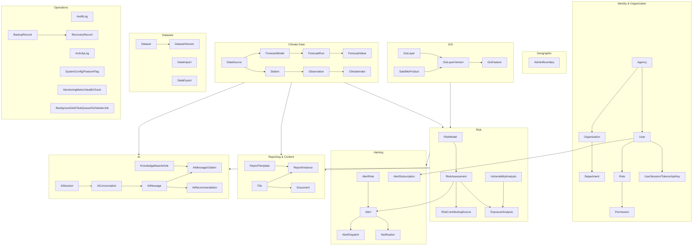

# Domain Model Overview

## Purpose

Complete inventory of every business entity in ClimateShield Nexus — the master index for [`docs/models/`](.), where each entity's full specification (purpose, relationships, lifecycle, constraints, indexes, permissions, validation, business notes, retention) lives. This document answers "what entities exist and where is each one specified" so no developer ever needs to ask what a table should contain — it either already exists here, or its absence is a gap to flag, not a decision to make ad hoc.

> Version: 1.0 | Author: ClimateShield Nexus Database Architecture Team | Last Updated: 2026-07-27

## Table of Contents

1. [How This Differs From docs/09_Database_Dictionary.md](#how-this-differs-from-docs09_database_dictionarymd)
2. [Entity Categories](#entity-categories)
3. [Complete Entity Index](#complete-entity-index)
4. [Master Domain Diagram](#master-domain-diagram)
5. [Entity Specification Template](#entity-specification-template)
6. [References](#references)
7. [Revision History](#revision-history)

## How This Differs From docs/09_Database_Dictionary.md

[`docs/09_Database_Dictionary.md`](../09_Database_Dictionary.md) is the column-level data dictionary (data types, constraints per column) and remains authoritative for exact SQL types — implemented concretely in [`database/schema/`](../../database/schema/). This `docs/models/` set is the **governance and lifecycle** layer on top: who owns each entity, what permission model applies, how it moves through states, what business rules aren't obvious from a column list, and how long it's retained. Read both together; neither replaces the other.

## Entity Categories

| # | Category | Doc | Entity Count |
|---|---|---|---|
| 1 | Identity & Organization | [`01_Identity_and_Organization_Entities.md`](01_Identity_and_Organization_Entities.md) | 13 |
| 2 | Geographic | [`02_Geographic_Entities.md`](02_Geographic_Entities.md) | 1 |
| 3 | Climate Data (incl. lookups) | [`03_Climate_Data_Entities.md`](03_Climate_Data_Entities.md) | 11 |
| 4 | GIS | [`04_GIS_Entities.md`](04_GIS_Entities.md) | 6 |
| 5 | Risk & Hazard | [`05_Risk_and_Hazard_Entities.md`](05_Risk_and_Hazard_Entities.md) | 8 |
| 6 | Alerting | [`06_Alerting_Entities.md`](06_Alerting_Entities.md) | 7 |
| 7 | Reporting & Content | [`07_Reporting_Entities.md`](07_Reporting_Entities.md) | 4 |
| 8 | AI | [`08_AI_Entities.md`](08_AI_Entities.md) | 7 |
| 9 | Datasets | [`09_Dataset_Entities.md`](09_Dataset_Entities.md) | 4 |
| 10 | Operations | [`10_Operations_Entities.md`](10_Operations_Entities.md) | 12 |

**73 entities total.**

## Complete Entity Index

| Entity | Category | SQL Table |
|---|---|---|
| Agency | Identity | `identity.agency` |
| Organization | Identity | `identity.organization` |
| Department | Identity | `identity.department` |
| User | Identity | `identity."user"` |
| Role | Identity | `identity.role` |
| Permission | Identity | `identity.permission` |
| RolePermission | Identity | `identity.role_permission` |
| UserSession | Identity | `identity.user_session` |
| PasswordResetToken | Identity | `identity.password_reset_token` |
| EmailVerificationToken | Identity | `identity.email_verification_token` |
| ApiKey | Identity | `identity.api_key` |
| ApiKeyUsage | Identity | `identity.api_key_usage` |
| WebhookSubscription | Identity | `identity.webhook_subscription` |
| AdminBoundary (Counties/Subcounties) | Geographic | `spatial.admin_boundary` |
| DataSource | Climate Data | `climate.data_source` |
| ClimateStation | Climate Data | `climate.station` |
| WeatherObservation | Climate Data | `climate.observation` |
| ForecastModel | Climate Data | `climate.forecast_model` |
| ForecastRun | Climate Data | `climate.forecast_run` |
| ForecastValue | Climate Data | `climate.forecast_value` |
| ClimateIndex | Climate Data | `climate.climate_index` |
| HazardTypeLookup | Climate Data (lookup) | `climate.hazard_type_lookup` |
| SeverityLookup | Climate Data (lookup) | `climate.severity_lookup` |
| UnitLookup | Climate Data (lookup) | `climate.unit_lookup` |
| ClimateVariableLookup | Climate Data (lookup) | `climate.climate_variable_lookup` |
| GisLayer | GIS | `spatial.gis_layer` |
| GisLayerVersion | GIS | `spatial.gis_layer_version` |
| RasterLayerMetadata | GIS | `spatial.raster_layer_metadata` |
| VectorLayerMetadata | GIS | `spatial.vector_layer_metadata` |
| GisFeature | GIS | `spatial.gis_feature` |
| SatelliteProduct (Satellite Images) | GIS | `spatial.satellite_product` |
| RiskModel | Risk | `risk.risk_model` |
| FloodModelParameters | Risk | `risk.flood_model_parameters` |
| DroughtModelParameters | Risk | `risk.drought_model_parameters` |
| HeatwaveModelParameters | Risk | `risk.heatwave_model_parameters` |
| RiskAssessment | Risk | `risk.risk_assessment` |
| RiskContributingSource | Risk | `risk.risk_contributing_source` |
| VulnerabilityAnalysis | Risk | `risk.vulnerability_analysis` |
| ExposureAnalysis | Risk | `risk.exposure_analysis` |
| AlertRule | Alerting | `warning.alert_rule` |
| AlertChannel | Alerting | `warning.alert_channel` |
| NotificationTemplate | Alerting | `warning.notification_template` |
| Alert (Early Warning Alert) | Alerting | `warning.alert` |
| AlertDispatch | Alerting | `warning.alert_dispatch` |
| AlertSubscription | Alerting | `warning.alert_subscription` |
| Notification | Alerting | `warning.notification` |
| File | Reporting & Content | `content.file` |
| Document | Reporting & Content | `content.document` |
| ReportTemplate | Reporting & Content | `content.report_template` |
| ReportInstance (Report) | Reporting & Content | `content.report_instance` |
| AiSession | AI | `ai.ai_session` |
| AiPrompt | AI | `ai.ai_prompt` |
| AiConversation | AI | `ai.ai_conversation` |
| AiMessage | AI | `ai.ai_message` |
| AiMessageCitation | AI | `ai.ai_message_citation` |
| AiRecommendation | AI | `ai.ai_recommendation` |
| KnowledgeBaseArticle | AI | `ai.knowledge_base_article` |
| Dataset | Datasets | `content.dataset` |
| DatasetVersion | Datasets | `content.dataset_version` |
| DataImport | Datasets | `content.data_import` |
| DataExport | Datasets | `content.data_export` |
| AuditLog | Operations | `ops.audit_log` |
| ActivityLog | Operations | `ops.activity_log` |
| SystemConfig | Operations | `ops.system_config` |
| FeatureFlag | Operations | `ops.feature_flag` |
| MonitoringMetric | Operations | `ops.monitoring_metric` |
| HealthCheck | Operations | `ops.health_check` |
| TaskQueue | Operations | `ops.task_queue` |
| BackgroundJob | Operations | `ops.background_job` |
| SchedulerJob | Operations | `ops.scheduler_job` |
| PipelineRunLog | Operations | `ops.pipeline_run_log` |
| BackupRecord | Operations | `ops.backup_record` |
| RecoveryRecord | Operations | `ops.recovery_record` |

## Master Domain Diagram

## Entity Specification Template

Every entity in the category documents below uses this fixed field set:

| Field | Meaning |
|---|---|
| Purpose | Why this entity exists, one sentence |
| Description | What it represents in plain language |
| Owner | Which service/team is authoritative for writes (per [`docs/40_Developer_Assignment.md`](../40_Developer_Assignment.md)) |
| Relationships | Parent/child/reference FKs, summarized (full detail in [`database/schema/`](../../database/schema/)) |
| Lifecycle | How a row is created, transitions, and is retired |
| Constraints | Key invariants enforced at the database level |
| Indexes | Query patterns this entity is optimized for |
| Permissions | Which roles can view/create/edit/delete/approve/export, per [`docs/13_Security_Design.md#rbac-matrix`](../13_Security_Design.md#rbac-matrix) |
| Validation | Link to the field-level rules in [`docs/validation/`](../validation/) |
| Business Notes | Non-obvious rules a column list alone wouldn't convey |
| Retention Policy | How long kept and why, per [`docs/30_Backup_and_Recovery.md#retention-policy`](../30_Backup_and_Recovery.md#retention-policy) |

## References

- [`docs/09_Database_Dictionary.md`](../09_Database_Dictionary.md)
- [`docs/07_ERD.md`](../07_ERD.md), [`docs/diagrams/06_Complete_ERD.md`](../diagrams/06_Complete_ERD.md)
- [`database/schema/`](../../database/schema/)
- [`docs/validation/`](../validation/)

## Revision History

| Version | Date | Author | Change |
|---|---|---|---|
| 1.0 | 2026-07-27 | ClimateShield Nexus Database Architecture Team | Initial version (Phase 4 data layer) |
