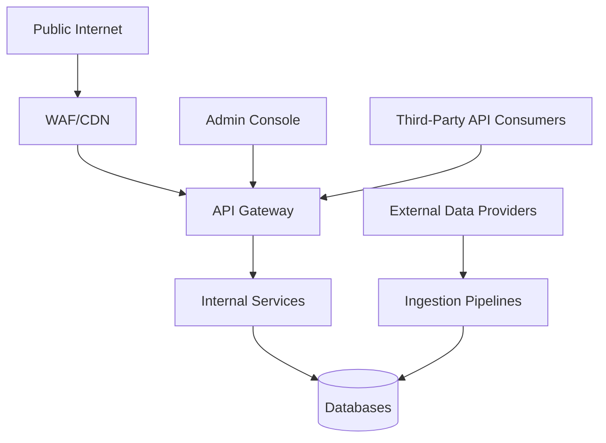

# Threat Model Worksheet

## Purpose

Asset-by-asset threat modeling worksheet, expanding the STRIDE summary in [`docs/13_Security_Design.md`](../13_Security_Design.md#threat-model-stride) with concrete assets, attack surfaces, and control ownership.

> Version: 1.0 | Author: ClimateShield Nexus Security Engineering | Last Updated: 2026-07-27

## Table of Contents

1. [Methodology](#methodology)
2. [Asset Inventory](#asset-inventory)
3. [Attack Surface Map](#attack-surface-map)
4. [Threat Worksheet](#threat-worksheet)
5. [Residual Risk](#residual-risk)
6. [References](#references)
7. [Revision History](#revision-history)

## Methodology

STRIDE per asset, DREAD-style qualitative scoring (Damage, Reproducibility, Exploitability, Affected users, Discoverability — each Low/Med/High), reviewed at each Architecture Sync ([`docs/32_Project_Development_Plan.md`](../32_Project_Development_Plan.md#ceremonies)) and before each major release.

## Asset Inventory

| Asset | Sensitivity | Owning Service |
|---|---|---|
| User credentials / session tokens | Critical | Auth Service |
| Audit log (hash chain) | Critical | Admin/Audit Service |
| Risk assessment data | Restricted | Risk Assessment Service |
| Population exposure data | Restricted | Risk Assessment Service |
| Alert dispatch queue | Critical | Alerting Service |
| API keys | Critical | Admin/Audit Service |
| Raw/processed climate data | Internal | Climate Data Service |
| Public dashboards/alerts | Public | Multiple |

## Attack Surface Map

## Threat Worksheet

| Asset | Threat (STRIDE) | Vector | Control | DREAD (qual.) |
|---|---|---|---|---|
| Credentials | Spoofing | Credential stuffing | Rate limiting, MFA, breached-password check ([`docs/28_Validation_Rules.md`](../28_Validation_Rules.md#user--access-validation)) | Med |
| Audit log | Tampering | Direct DB write bypassing app layer | Append-only DB trigger + hash chain ([`docs/13_Security_Design.md`](../13_Security_Design.md#audit-integrity)) | High damage, low likelihood |
| Alert dispatch | Denial of Service | Traffic flood during real event | WAF, rate limiting, priority queue, auto-scaling | High |
| Population exposure data | Information Disclosure | IDOR via crafted API request | Server-side RBAC re-check on every request ([`SRS-AUTHZ-005`](../04_Functional_Requirements.md#authorization)) | High damage, med likelihood |
| API keys | Information Disclosure | Leaked key in client-side code / public repo | Secret scanning in CI, key scoping, rotation runbook ([`docs/36_System_Maintenance.md`](../36_System_Maintenance.md#runbook-rotating-api-keys--secrets)) | Med |
| Ingestion pipeline | Tampering | Malicious/corrupted upstream data source | Validation layer, range/consistency checks ([`docs/28_Validation_Rules.md`](../28_Validation_Rules.md)) | Med |
| Admin console | Elevation of Privilege | Session hijack of Administrator account | MFA, short session TTL, session revocation ([`SRS-AUTH-008`](../04_Functional_Requirements.md#authentication)) | High |

## Residual Risk

After controls, the highest residual risk is **Denial of Service against the Alerting path during an active severe-weather event** — the moment of highest both attacker incentive (if malicious) and organic traffic spike. Mitigations in [`docs/06_System_Architecture.md`](../06_System_Architecture.md#resilience--failure-handling) reduce but do not eliminate this; manual fallback runbook exists ([`docs/36_System_Maintenance.md`](../36_System_Maintenance.md#runbook-manual-alert-dispatch-channel-outage)).

## References

- [`docs/13_Security_Design.md`](../13_Security_Design.md)
- [`docs/18_Risk_Assessment.md`](../18_Risk_Assessment.md)
- [`pentest-plan.md`](pentest-plan.md)

## Revision History

| Version | Date | Author | Change |
|---|---|---|---|
| 1.0 | 2026-07-27 | ClimateShield Nexus Security Engineering | Initial version |
