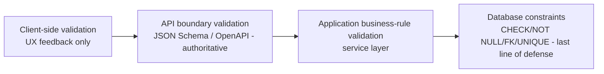

# Validation Framework

## Purpose

Defines the categories of validation rule used consistently across every field in [`docs/validation/`](.), and where each category is enforced (database CHECK constraint vs. application-layer validation vs. both). Extends [`docs/28_Validation_Rules.md`](../28_Validation_Rules.md) (business/pipeline-level validation) down to individual-field precision for the entities specified in [`docs/models/`](../models/).

> Version: 1.0 | Author: ClimateShield Nexus Data Engineering Team | Last Updated: 2026-07-27

## Table of Contents

1. [Relationship to docs/28_Validation_Rules.md](#relationship-to-docs28_validation_rulesmd)
2. [Rule Categories](#rule-categories)
3. [Enforcement Layers](#enforcement-layers)
4. [Notation Used in Category Documents](#notation-used-in-category-documents)
5. [Category Document Index](#category-document-index)
6. [References](#references)
7. [Revision History](#revision-history)

## Relationship to docs/28_Validation_Rules.md

[`docs/28_Validation_Rules.md`](../28_Validation_Rules.md) defines validation **by pipeline stage and business rule** (e.g., "rainfall > 500mm flags for secondary confirmation"). This document set defines validation **by field**, exhaustively, for every column in every table in [`database/schema/`](../../database/schema/) — the two are complementary views of the same rules, not competing sources of truth. Where they overlap, the specific numeric thresholds in `docs/28_Validation_Rules.md` are authoritative; this document adds the fields `docs/28` doesn't enumerate (identity, GIS, AI, operations).

## Rule Categories

| Category | Meaning | Example |
|---|---|---|
| Required | Field must be present (NOT NULL) | `user.email` |
| Nullable | Field may be absent, with a defined meaning for absence | `user.password_hash` (NULL = SSO-only account) |
| Regex | Field must match a pattern | Email format, hex color codes, CAP identifier format |
| Min/Max Length | String length bounds | `agency.country_code` exactly 2 chars |
| Range | Numeric bounds | `risk_assessment.confidence_score` in [0,1] |
| Allowed Values | Enumerated set | `risk_assessment.severity` ∈ {low,moderate,high,severe,extreme} |
| Date Rules | Temporal ordering/bounds | `alert.expires_at > alert.created_at` |
| File Rules | Upload constraints | Max size, allowed MIME types, checksum format |
| Spatial Rules | Geometry validity/type/CRS | `ST_IsValid`, SRID 4326, geometry type match |
| Climate Rules | Domain-specific plausibility bounds | Temperature -10°C to 50°C for Kenya |

## Enforcement Layers

Every rule in this document set states which layer(s) enforce it. A rule enforced ONLY at the database layer is flagged — this means the API/application layer must still surface it as a friendly error rather than letting a raw constraint-violation error reach a user, per [`docs/12_API_Specification.md#error-format`](../12_API_Specification.md#error-format).

## Notation Used in Category Documents

Each entity section is a table with one row per field requiring a non-trivial rule (fields with only "NOT NULL, correct type" are omitted for brevity — that baseline is already fully specified in [`database/schema/`](../../database/schema/) and doesn't need restating):

| Column | Meaning |
|---|---|
| Field | Table.column |
| Category | One of the [Rule Categories](#rule-categories) above |
| Rule | The specific rule |
| Enforced By | DB / API / App / DB+API |

## Category Document Index

| Document | Covers |
|---|---|
| [`01_Identity_Validation_Rules.md`](01_Identity_Validation_Rules.md) | Agency, Organization, Department, User, Role, Permission, Sessions, Tokens, API Keys |
| [`02_Climate_Data_Validation_Rules.md`](02_Climate_Data_Validation_Rules.md) | Stations, Observations, Forecasts, Climate Indices, Lookups |
| [`03_GIS_Validation_Rules.md`](03_GIS_Validation_Rules.md) | Admin Boundaries, GIS Layers, Features, Satellite Products |
| [`04_Risk_Validation_Rules.md`](04_Risk_Validation_Rules.md) | Risk Models, Assessments, Exposure/Vulnerability |
| [`05_Alerting_Validation_Rules.md`](05_Alerting_Validation_Rules.md) | Alert Rules, Channels, Templates, Alerts, Dispatch, Subscriptions, Notifications |
| [`06_AI_and_Content_Validation_Rules.md`](06_AI_and_Content_Validation_Rules.md) | AI entities, Files, Documents, Reports, Datasets |
| [`07_Operations_Validation_Rules.md`](07_Operations_Validation_Rules.md) | Audit/Activity Logs, Config, Feature Flags, Monitoring, Jobs, Backups |

## References

- [`docs/28_Validation_Rules.md`](../28_Validation_Rules.md)
- [`docs/models/`](../models/)
- [`database/schema/`](../../database/schema/)
- [`shared/schemas/`](../../shared/schemas/)

## Revision History

| Version | Date | Author | Change |
|---|---|---|---|
| 1.0 | 2026-07-27 | ClimateShield Nexus Data Engineering Team | Initial version (Phase 4 data layer) |
