# Business Workflows

## Purpose

End-to-end lifecycle workflows crossing roles, systems, and data states for ClimateShield Nexus's core business processes. Distinct from the system-internal [Activity Diagrams](../diagrams/12_Activity_Diagrams_Extended.md) (process-step view) and [User Flows](../diagrams/04_User_Flows.md) (screen-navigation view) — these diagrams emphasize **role handoffs and business decision gates** across the full lifecycle of a workflow.

> Version: 1.0 | Author: ClimateShield Nexus Product & Architecture Team | Last Updated: 2026-07-27

## Table of Contents

1. [Climate Data Lifecycle](#climate-data-lifecycle)
2. [Forecast Lifecycle](#forecast-lifecycle)
3. [AI Decision Workflow](#ai-decision-workflow)
4. [Risk Assessment Workflow](#risk-assessment-workflow)
5. [User Management Workflow](#user-management-workflow)
6. [Report Workflow](#report-workflow)
7. [Authentication Workflow](#authentication-workflow)
8. [Notification Workflow](#notification-workflow)
9. [Dataset Validation Workflow](#dataset-validation-workflow)
10. [Machine Learning Workflow](#machine-learning-workflow)
11. [GIS Workflow](#gis-workflow)
12. [Deployment Workflow](#deployment-workflow)
13. [Maintenance Workflow](#maintenance-workflow)
14. [References](#references)
15. [Revision History](#revision-history)

## Climate Data Lifecycle

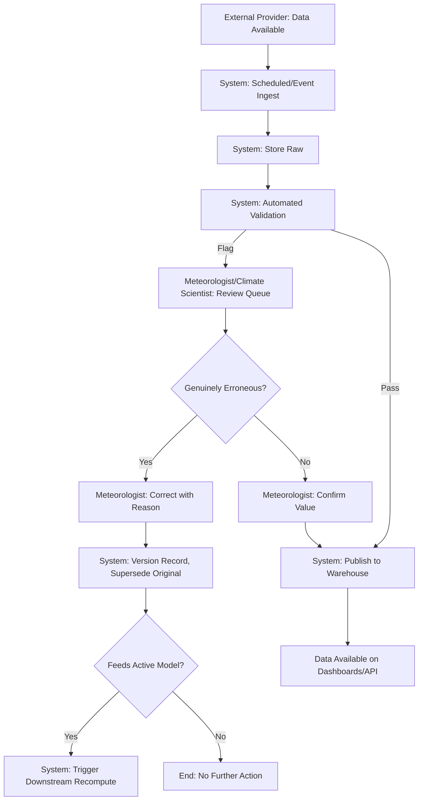

Full state machine: [`docs/23_State_Diagrams.md#observation-correction-lifecycle`](../23_State_Diagrams.md#observation-correction-lifecycle).

## Forecast Lifecycle

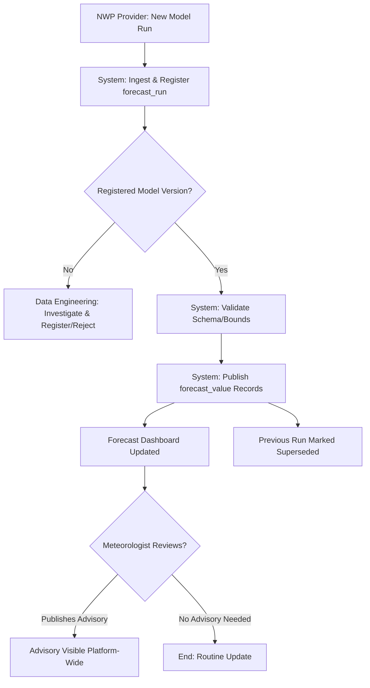

Full state machine: [`docs/diagrams/11_State_Diagrams_Extended.md#forecast-lifecycle`](../diagrams/11_State_Diagrams_Extended.md#forecast-lifecycle).

## AI Decision Workflow

```mermaid
flowchart TD
    A[User: Submits Query] --> B[System: RBAC Scope Check]
    B --> C[System: Retrieve Context - KB + Live Data]
    C --> D[System: LLM Generates Draft]
    D --> E{Citation Present?}
    E -->|No| F[System: Withhold, Return "Insufficient Data"]
    E -->|Yes| G{Confidence >= Threshold AND Not High-Stakes?}
    G -->|Yes| H[System: Return Actionable Response]
    G -->|No| I[System: Return Response + "Human Review Required"]
    I --> J[Relevant Role: Reviews Recommendation]
    J --> K{Role Approves?}
    K -->|Yes| L[Recommendation Actioned - e.g., Advisory Published]
    K -->|No| M[Recommendation Discarded, Feedback Logged]
```

Full state machine: [`docs/diagrams/11_State_Diagrams_Extended.md#ai-job-lifecycle`](../diagrams/11_State_Diagrams_Extended.md#ai-job-lifecycle).

## Risk Assessment Workflow

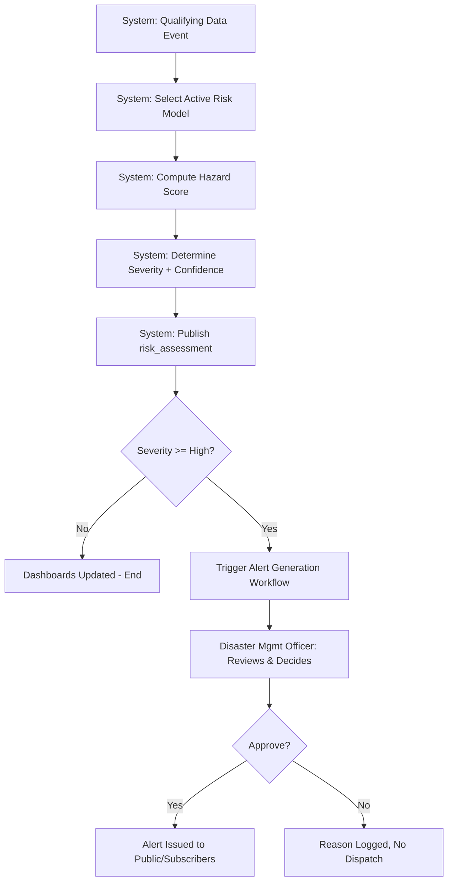

Full state machine: [`docs/23_State_Diagrams.md#risk-assessment-lifecycle`](../23_State_Diagrams.md#risk-assessment-lifecycle).

## User Management Workflow

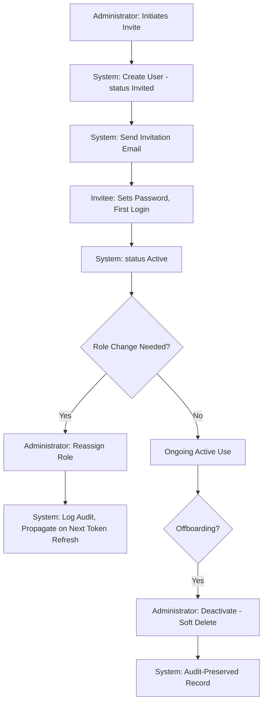

Full state machine: [`docs/23_State_Diagrams.md#user-account-lifecycle`](../23_State_Diagrams.md#user-account-lifecycle).

## Report Workflow

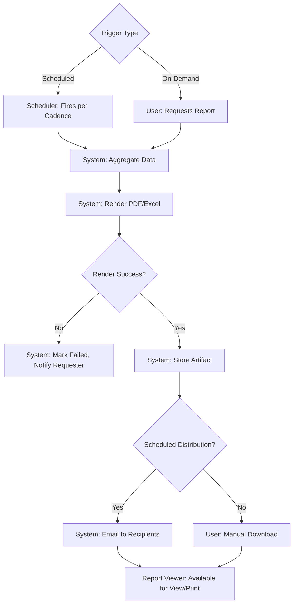

Full state machine: [`docs/23_State_Diagrams.md#report-instance-lifecycle`](../23_State_Diagrams.md#report-instance-lifecycle).

## Authentication Workflow

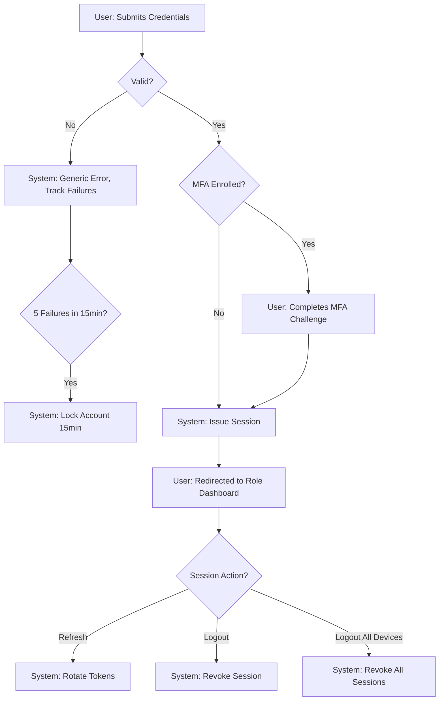

## Notification Workflow

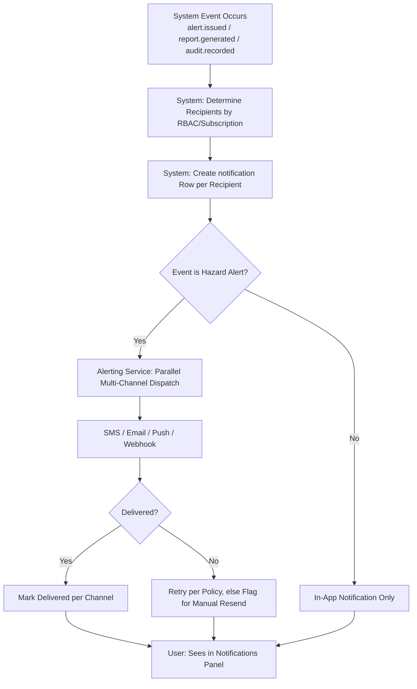

## Dataset Validation Workflow

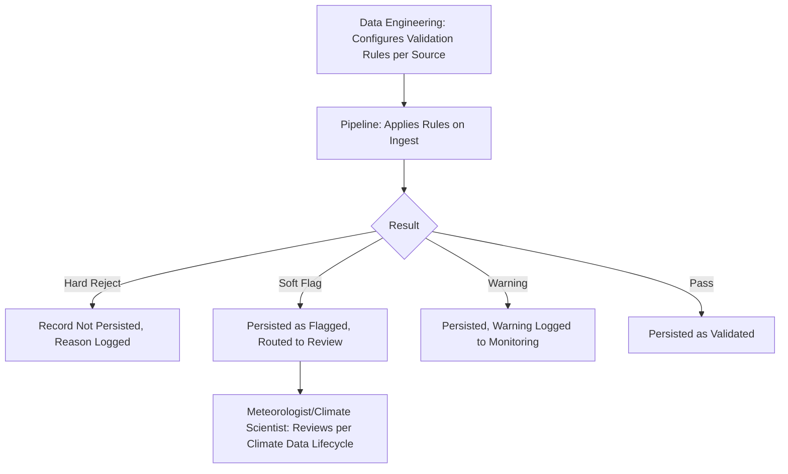

Rule catalog: [`docs/28_Validation_Rules.md`](../28_Validation_Rules.md).

## Machine Learning Workflow

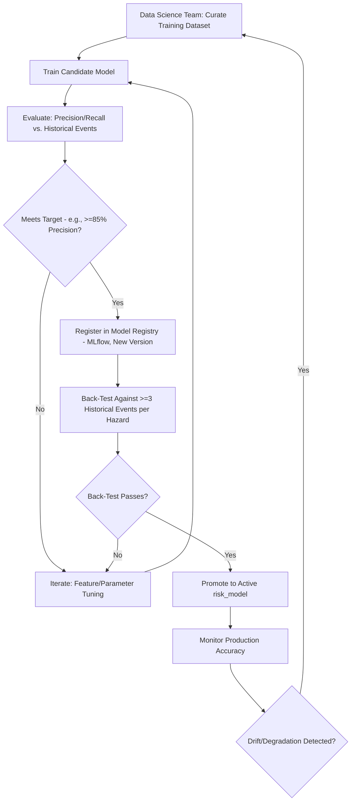

## GIS Workflow

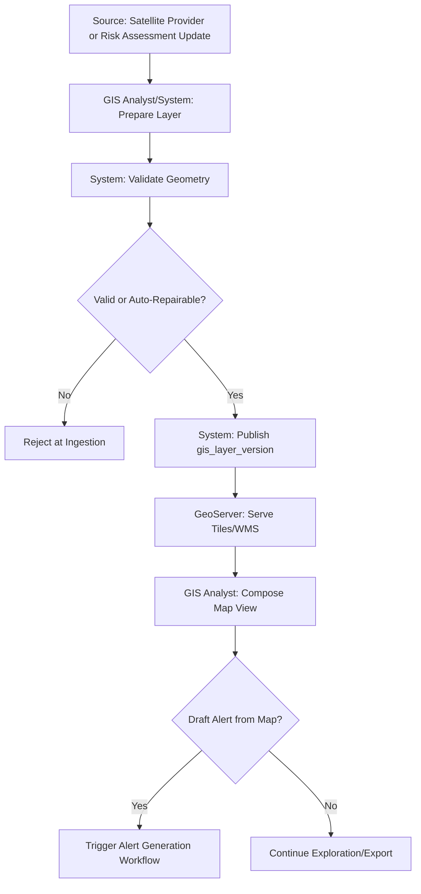

## Deployment Workflow

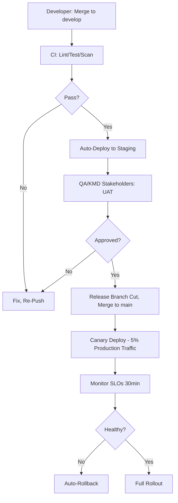

Full detail: [`docs/15_Deployment_Guide.md`](../15_Deployment_Guide.md), [`docs/workflows/02_DevOps_Visuals.md`](02_DevOps_Visuals.md).

## Maintenance Workflow

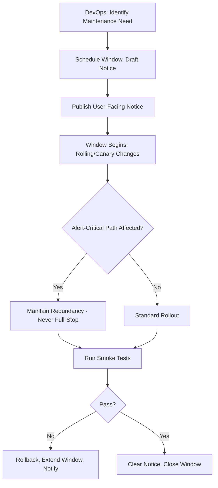

## References

- [`docs/02_Business_Requirements.md#business-process-overview`](../02_Business_Requirements.md#business-process-overview)
- [`docs/24_Activity_Diagrams.md`](../24_Activity_Diagrams.md)
- [`docs/diagrams/12_Activity_Diagrams_Extended.md`](../diagrams/12_Activity_Diagrams_Extended.md)
- [`docs/23_State_Diagrams.md`](../23_State_Diagrams.md)

## Revision History

| Version | Date | Author | Change |
|---|---|---|---|
| 1.0 | 2026-07-27 | ClimateShield Nexus Product & Architecture Team | Initial version (Phase 2 visual design package) |
