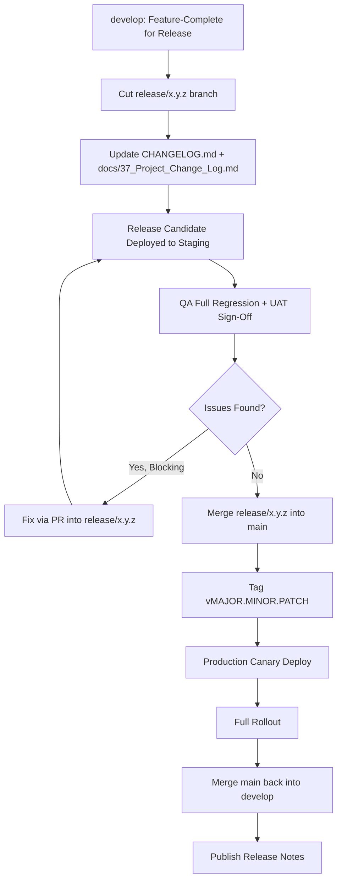
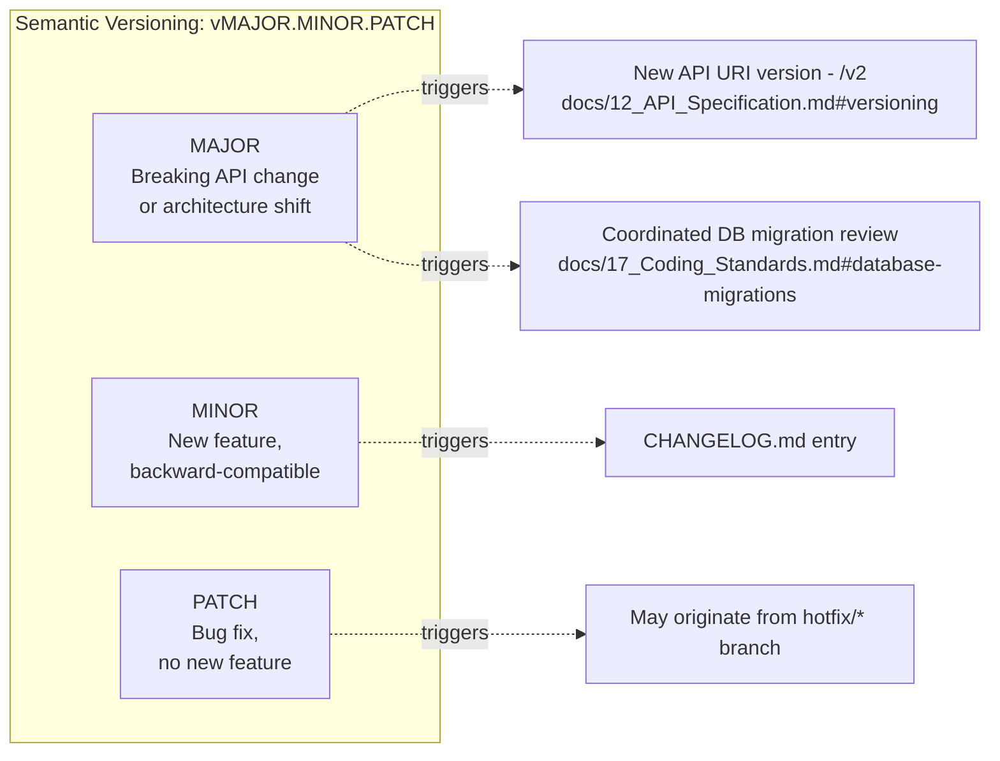
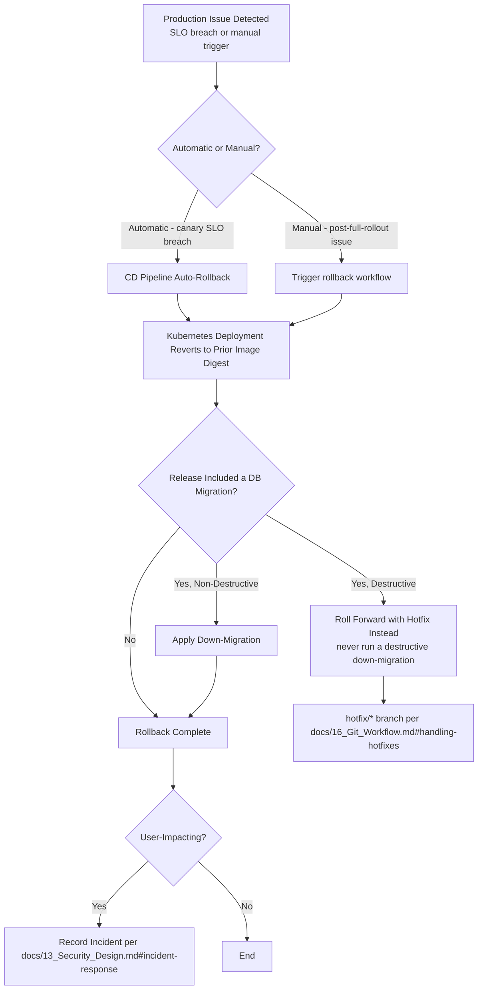

# DevOps Visuals

## Purpose

Visualizes ClimateShield Nexus's software delivery process — Git workflow, CI/CD pipelines, release management, branching, versioning, and rollback — extending [`docs/16_Git_Workflow.md`](../16_Git_Workflow.md) and [`docs/15_Deployment_Guide.md`](../15_Deployment_Guide.md) with the diagrams not yet covered there (Release Pipeline, Version Strategy, Rollback Strategy) and cross-referencing the ones that are.

> Version: 1.0 | Author: ClimateShield Nexus DevOps Team | Last Updated: 2026-07-27

## Table of Contents

1. [Coverage Index](#coverage-index)
2. [Git Workflow](#git-workflow)
3. [Branch Strategy](#branch-strategy)
4. [CI Pipeline](#ci-pipeline)
5. [CD Pipeline](#cd-pipeline)
6. [Release Pipeline](#release-pipeline)
7. [Version Strategy](#version-strategy)
8. [Rollback Strategy](#rollback-strategy)
9. [References](#references)
10. [Revision History](#revision-history)

## Coverage Index

| Requested Diagram | Location |
|---|---|
| Git Workflow | [`docs/16_Git_Workflow.md#branching-model`](../16_Git_Workflow.md#branching-model) (referenced below) |
| CI Pipeline | [`docs/15_Deployment_Guide.md#cicd-pipeline`](../15_Deployment_Guide.md#cicd-pipeline) (referenced below) |
| CD Pipeline | [`docs/15_Deployment_Guide.md#cicd-pipeline`](../15_Deployment_Guide.md#cicd-pipeline) (referenced below) |
| Release Pipeline | [This document](#release-pipeline) (new) |
| Branch Strategy | [`docs/16_Git_Workflow.md#branching-model`](../16_Git_Workflow.md#branching-model) (referenced below) |
| Version Strategy | [This document](#version-strategy) (new) |
| Rollback Strategy | [This document](#rollback-strategy) (new) |

## Git Workflow

See [`docs/16_Git_Workflow.md#branching-model`](../16_Git_Workflow.md#branching-model) for the authoritative diagram (trunk-based with short-lived feature branches, gitflow-lite for releases). Commit/PR conventions: [`docs/16_Git_Workflow.md#commit-convention`](../16_Git_Workflow.md#commit-convention).

## Branch Strategy

See [`docs/16_Git_Workflow.md#branching-model`](../16_Git_Workflow.md#branching-model) and [`docs/16_Git_Workflow.md#branch-protection-rules`](../16_Git_Workflow.md#branch-protection-rules) — `main` (production, protected, 2 approvals), `develop` (integration, auto-deploys to Staging), `feature/fix/docs/chore/*` (short-lived), `release/x.y.z` (stabilization), `hotfix/*` (urgent production fixes).

## CI Pipeline

See [`docs/15_Deployment_Guide.md#cicd-pipeline`](../15_Deployment_Guide.md#cicd-pipeline) for the full PR → Lint → Unit Tests → SAST/SCA → Build → Integration Tests → Push diagram, implemented in [`.github/workflows/ci.yml`](../../.github/workflows/ci.yml) and [`.github/workflows/build.yml`](../../.github/workflows/build.yml).

## CD Pipeline

See [`docs/15_Deployment_Guide.md#cicd-pipeline`](../15_Deployment_Guide.md#cicd-pipeline) for the Staging deploy → E2E → Manual Approval → Production Canary → Monitor → Full Rollout diagram, implemented in [`.github/workflows/deploy-staging.yml`](../../.github/workflows/deploy-staging.yml) and [`.github/workflows/deploy-production.yml`](../../.github/workflows/deploy-production.yml).

## Release Pipeline

Release notes are generated from Conventional Commit history per [`docs/16_Git_Workflow.md#tagging--releases`](../16_Git_Workflow.md#tagging--releases).

## Version Strategy

| Component | Versioning |
|---|---|
| Platform release (this blueprint's deliverable) | `vMAJOR.MINOR.PATCH` per [`docs/16_Git_Workflow.md#tagging--releases`](../16_Git_Workflow.md#tagging--releases) |
| REST API | URI major version only (`/v1`, `/v2`); minor/patch changes are additive within a version, per [`docs/12_API_Specification.md#versioning`](../12_API_Specification.md#versioning) |
| Risk/Forecast Models | Independent semantic version string per `risk_model`/`forecast_model` row, decoupled from platform release cadence — a model can be updated without a platform deploy |
| Container images | Tagged with git SHA + semantic version, pinned by digest in Kubernetes manifests |

## Rollback Strategy

Migrations are designed to be additive-first specifically so this rollback path almost always terminates at "non-destructive down-migration" rather than "roll forward with hotfix" — see [`docs/17_Coding_Standards.md#database-migrations`](../17_Coding_Standards.md#database-migrations).

## References

- [`docs/16_Git_Workflow.md`](../16_Git_Workflow.md)
- [`docs/15_Deployment_Guide.md`](../15_Deployment_Guide.md)
- [`docs/37_Project_Change_Log.md`](../37_Project_Change_Log.md)
- [`.github/workflows/`](../../.github/workflows/)

## Revision History

| Version | Date | Author | Change |
|---|---|---|---|
| 1.0 | 2026-07-27 | ClimateShield Nexus DevOps Team | Initial version (Phase 2 visual design package) |
